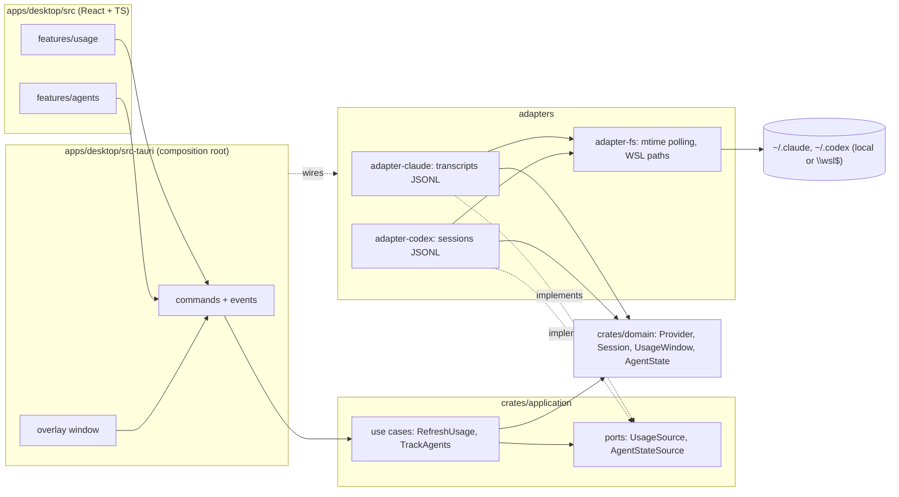

# INSTALL.md - AgentHud

Vision technique et guide d'installation.

## Vision

Afficher à l'écran, en surimpression, le statut de nos LLM favoris : usage des sessions et état des agents.

AgentHud est un overlay Windows léger, toujours au premier plan et click-through. Il montre l'usage des fenêtres 5 h et hebdomadaire de Claude et Codex, ainsi que l'état de chaque agent : en attente, working, idle ou hors ligne. Outil perso, destiné à l'open source.

Sa différence tient en trois points :
- **Indépendance totale :** l'overlay se contente de lire les fichiers que les CLI écrivent déjà. Il n'installe aucun hook, ne demande aucune configuration et n'utilise aucun token.
- **Respect des règles d'usage :** il ne fait aucun appel réseau aux providers.
- **Évolutivité :** chaque LLM est un adapter isolé.

## Decisions

| Decision     | Choice                                                                 | Why                                                                                              |
| ------------ | ---------------------------------------------------------------------- | ------------------------------------------------------------------------------------------------ |
| Architecture | Monolithe modulaire desktop, DDD et hexagonal, workspace Cargo          | Un seul utilisateur, un seul exe. Un adapter par LLM, sans toucher au domaine. Exigence de clean code et d'évolutivité. |
| Front-end    | Vite + React + TypeScript, SPA dans la WebView2 (Tauri 2)               | L'équipe préfère TS. L'UI est réactive et l'exe pèse environ 10 Mo, sans Electron.               |
| Back-end     | Rust (cœur Tauri 2), `tokio` pour le polling                            | Le polling n'est pas ralenti par la WebView. Aucun secret n'est exposé côté JS. Faible empreinte RAM et CPU. |
| Database     | Aucune en v1 (config JSON) ; SQLite en v2 pour les stats                 | La v1 ne fait que lire des fichiers existants. Rien n'est persisté.                              |
| Auth         | Aucune, lecture passive de fichiers locaux                              | Pas d'appel réseau, pas de token. Évite tout conflit avec les règles d'usage d'Anthropic.        |
| Hosting      | Local ; `.exe` publié sur GitHub Releases, non signé en v1              | Budget de 0 €. Outil perso, open source plus tard.                                               |

## Stack summary

- **Front-end :** Vite, React, TypeScript, types générés depuis Rust via `tauri-specta`.
- **Back-end :** Rust stable et Tauri 2, avec `tokio`, `serde`/`serde_json` et `thiserror`. Fenêtre overlay transparente, `alwaysOnTop`, `set_ignore_cursor_events`.
- **Database :** aucune en v1. Config JSON dans le dossier de config de l'app.
- **Auth :** aucune.
- **Hosting :** GitHub Releases, build via GitHub Actions (`windows-latest`).
- **Key integrations :** toutes en lecture passive, sans configuration côté CLI :
  - **Claude Code :** transcripts `~/.claude/projects/*/*.jsonl`. Donne l'état de l'agent et les tokens. Le % de quota est **estimé**.
  - **Codex CLI :** sessions `~/.codex/sessions/**/*.jsonl`, événements `token_count` avec `rate_limits.primary` (5 h) et `secondary` (hebdo). Le % est exact.
  - **Accès aux fichiers :** chemins Windows natifs et `\\wsl.localhost\<distro>\...` ou `\\wsl$\...`.

## Architecture



Règles de dépendance :
- `domain` est pur, sans I/O, et ne dépend de rien.
- `application` définit les cas d'usage et les ports, et dépend uniquement de `domain`.
- Chaque adapter de provider implémente les ports et s'appuie sur `adapter-fs` pour l'accès aux fichiers.
- Seul `src-tauri` (composition root) assemble les modules. Il pousse les états à l'UI par des events Tauri.
- L'UI ne connaît que les commands et events typés.

Ajouter un LLM revient à créer un crate `adapter-<llm>`.

## Folder structure

```
AgentHud/
├─ Cargo.toml                    # workspace Rust
├─ package.json                  # scripts UI (pnpm)
├─ crates/
│  ├─ domain/                    # pur, sans I/O : Provider, Session, UsageWindow, AgentState
│  ├─ application/               # cas d'usage (RefreshUsage, TrackAgents) + ports
│  ├─ adapter-claude/            # transcripts ~/.claude/projects/*.jsonl
│  ├─ adapter-codex/             # sessions ~/.codex/sessions/*.jsonl
│  └─ adapter-fs/                # polling mtime, résolution chemins Windows et \\wsl$
├─ apps/
│  └─ desktop/
│     ├─ src-tauri/              # composition root : câblage, commands, events, fenêtre overlay
│     └─ src/                    # React + TS
│        ├─ features/usage/
│        ├─ features/agents/
│        └─ shared/              # types générés depuis Rust (tauri-specta)
├─ aidd_docs/INSTALL.md
└─ .github/workflows/release.yml # build .exe → GitHub Releases
```

## Install steps

Installation manuelle : le framework ne génère pas encore ces éléments automatiquement.

1. Dans WSL (Ubuntu), installer : `sudo apt install nsis lld llvm clang`, Rust stable (`rustup`), la cible `rustup target add x86_64-pc-windows-msvc`, `cargo install --locked cargo-xwin`, et `corepack enable pnpm`. Voir l'ADR 0001.
2. Vérifier que le runtime WebView2 est présent côté Windows. Il est inclus d'office dans Windows 10 et 11.
3. Garder le repo **dans WSL**. L'exe se cross-compile avec `pnpm tauri build --runner cargo-xwin --target x86_64-pc-windows-msvc`, puis se lance à la main côté Windows.
4. Créer le workspace Cargo et l'app Tauri 2 (`pnpm create tauri-app`, template React + TS), puis la déplacer dans `apps/desktop/`.
5. Créer les crates `domain`, `application`, `adapter-fs`, `adapter-claude` et `adapter-codex` (`cargo new --lib`), et déclarer les dépendances dans le sens des règles d'architecture.
6. Faire un premier prototype de 30 minutes : fenêtre transparente click-through, puis mesure de la RAM sur l'ensemble des processus `msedgewebview2.exe`. La cible est moins de 100 Mo ; sinon, régler `MemoryUsageTargetLevel=Low`.
7. Ajouter le workflow GitHub Actions `release.yml` (`tauri-action`, runner `windows-latest`) qui publie l'exe sur GitHub Releases.

## Audit summary

Résultats de l'audit multi-agents de l'étape 3 :

| Candidate              | Verdict | Notes                                                                                           |
| ---------------------- | ------- | ----------------------------------------------------------------------------------------------- |
| **A. Tauri 2, cœur Rust** ✔ retenu | ⚠️ | Exe d'environ 10 Mo. Le click-through est tout ou rien. RAM de la WebView2 à mesurer (environ 60 à 120 Mo). |
| B. C# WPF (.NET 10)    | ⚠️      | RAM de 40 à 70 Mo. Pas de trimming ni de NativeAOT, donc un exe de 60 à 80 Mo. Pas de TS, Windows uniquement. |
| C. Tauri 2, cœur TS    | ⚠️      | Timers ralentis quand la WebView est masquée. Permissions fs fragiles sur `\\wsl$`. Son correctif revient à A. |

Points transverses à tous les candidats :
- **Endpoint OAuth Claude écarté :** il est non officiel, renvoie des 429 et ses conditions interdisent les outils tiers depuis février 2026.
- **Surveillance des fichiers non fiable sur `\\wsl$` :** on fait du polling sur la date de modification (mtime).
- **Schémas JSONL non garantis :** ils peuvent changer entre versions des CLI, donc le parsing doit tolérer les écarts et afficher « inconnu » en cas de doute.
- **Exe non signé :** Windows affiche l'avertissement SmartScreen. Signature gratuite possible plus tard via SignPath pour l'open source.

## Backlog

- Adapters optionnels : hooks Claude et Codex (état en temps réel), `codex app-server` (`account/rateLimits/read`).
- v2 : projet courant de chaque agent (`cwd` ou dossier `projects/`).
- Plus tard : statistiques d'usage (SQLite).
