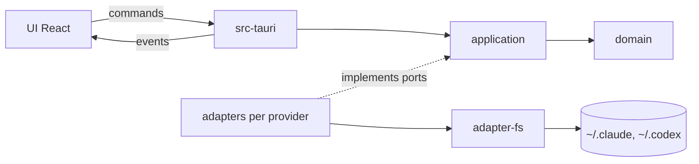

# Architecture

Vision complète et justification des choix : `aidd_docs/INSTALL.md`.

## Stack

- **Rust + Tauri** pour le cœur : polling, lecture des fichiers, déduction des états. Le travail de fond hors WebView évite le ralentissement des timers et ne laisse aucun secret côté JS.
- **React + TypeScript + Vite** pour l'UI, dans la WebView2.
- `tokio` pour le polling, `serde` pour le parsing JSONL, `thiserror` pour les erreurs typées.
- `tauri-specta` génère les types TS depuis Rust.

## How it fits together

## Key decisions

- **DDD et hexagonal :**
  - `domain` est pur, sans I/O.
  - `application` porte les cas d'usage et les ports (`UsageSource`, `AgentStateSource`).
  - Les adapters implémentent les ports.
  - Seul `src-tauri` assemble les modules (composition root).
  - `overlay` est hors de l'hexagone : c'est la logique pure de la fenêtre, sans dépendance interne, utilisée seulement par `src-tauri`.
- **Un adapter par provider.** Ajouter un LLM revient à créer `adapter-<llm>`, sans jamais toucher `domain`.
- **Lecture passive uniquement en v1.** L'app lit les fichiers que les CLI écrivent déjà. Elle n'installe aucun hook, ne demande aucune configuration et ne lance aucun processus.
- **Aucun appel à l'endpoint OAuth d'Anthropic.** Il est non officiel, renvoie des 429 et son usage dans un outil tiers est interdit par les conditions d'Anthropic. Le % du quota Claude est donc **estimé** à partir des tokens des transcripts.
- **Polling sur la date de modification (mtime) toutes les 2 à 5 s,** jamais de surveillance des fichiers. `ReadDirectoryChangesW` n'est pas fiable sur `\\wsl$`.
- **Build dans WSL, avec l'exe Windows cross-compilé par `cargo-xwin`.** L'agent ne lance jamais d'outil Windows : sandbox oblige. L'humain lance l'exe. Voir `aidd_docs/adr/0001-cross-compile-windows-from-wsl.md`.
- **Un provider peut cumuler plusieurs sources,** de la plus fiable à la moins fiable. Les sources optionnelles (hooks, `codex app-server`) viennent après les sources passives.

## Gotchas

- Les schémas JSONL de Claude et Codex changent d'une version à l'autre (par exemple `resets_at` ou `resets_in_seconds`, et des fenêtres qui peuvent valoir `null`). Le parsing doit être défensif : en cas de doute, afficher `unknown`, ne jamais planter.
- Les données des CLI peuvent se trouver dans WSL. Il faut résoudre `\\wsl.localhost\<distro>\home\<user>\...` comme `\\wsl$\...`. Le polling ne doit pas réveiller une distro arrêtée.
- La RAM se mesure sur **tous** les processus `msedgewebview2.exe`. La cible est moins de 100 Mo.
