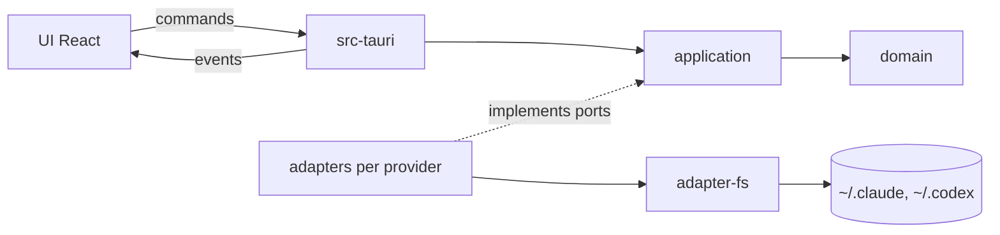

# Architecture

Vision complète et justification des choix : `aidd_docs/INSTALL.md`.

## Stack

- **Rust + Tauri** pour le cœur : polling, lecture des fichiers, déduction des états. Le travail de fond hors WebView évite le ralentissement des timers et ne laisse aucun secret côté JS.
- **React + TypeScript + Vite** pour l'UI, dans la WebView2.
- `tokio` pour le polling, `serde` pour le parsing JSONL, `thiserror` pour les erreurs typées.
- Types TS des commands et events écrits à la main, en miroir des DTO Rust (`UsageReport` dans `application`, `useUsage.ts` côté UI). `tauri-specta` est écarté : il n'existe qu'en release candidate, et il génère les types en exécutant l'app, ce qui est impossible depuis WSL (ADR 0001).

## How it fits together

## Key decisions

- **DDD et hexagonal :**
  - `domain` est pur, sans I/O.
  - `application` porte les cas d'usage (`RefreshUsage`, `TrackAgents`, `PolledUsage`), le planificateur `PollScheduler` et les ports (`UsageSource`, `UsageFetcher`, `AgentStateSource`).
  - Les adapters implémentent les ports (`UsageSource`, `UsageFetcher`, `AgentStateSource`).
  - Seul `src-tauri` assemble les modules (composition root).
  - `overlay` est hors de l'hexagone : c'est la logique pure de la fenêtre, sans dépendance interne, utilisée seulement par `src-tauri`.
- **Un adapter par provider.** Ajouter un LLM revient à créer `adapter-<llm>`, sans jamais toucher `domain`.
- **Lecture passive par défaut** (ADR 0002 pour les exceptions). L'app lit les fichiers que les CLI écrivent déjà. Elle n'installe aucun hook, ne modifie jamais les réglages des CLI et ne lance aucun agent. Processus externes : `wsl.exe --list --running --quiet` (distros démarrées) et `codex app-server` (option, voir plus bas).
- **Sources de l'usage, par provider (ADR 0002).** `FreshestUsage` (`application`) garde la meilleure : une donnée exacte (%) l'emporte sur une estimation, puis la plus récente gagne. Chaque rapport porte sa source (`source`).
  - Codex : sessions JSONL (`sessions`) et `codex app-server` (`app-server`, méthode `account/rateLimits/read`, JSON-RPC sans champ `jsonrpc` sur stdio). App-server est lancé à chaque sondage puis arrêté : `codex.exe` ou `codex.cmd` du `PATH` Windows, puis `wsl.exe -d <distro> --exec sh -lc 'exec codex app-server'` pour chaque distro **déjà démarrée** (`CachedLister`). Option du tray, activée par défaut.
  - Claude, source officielle : le script de statusline fourni (`scripts/statusline/`) copie les `rate_limits` reçus de Claude Code dans `<.claude>/agenthud/rate-limits.json`, lu passivement sur chaque racine (`statusline`). L'utilisateur l'installe lui-même ; l'app ne touche jamais aux réglages de Claude Code.
  - Claude, mode dégradé : `GET https://api.anthropic.com/api/oauth/usage` (`oauth`), le seul accès réseau de l'app. Non autorisé par Anthropic, risque de blocage du compte. Option du tray **désactivée par défaut**, utilisée seulement si la statusline n'a rien écrit depuis 15 min (`STATUSLINE_FRESH_FOR`). Le token `claudeAiOauth.accessToken` est relu dans `<.claude>/.credentials.json` à chaque appel, jamais stocké, journalisé ni envoyé à JS. Client `ureq` (rustls + ring) : 3 s de connexion, 8 s au total, sans redirection.
  - Claude, sinon : **tokens estimés** (`estimate`) sur un bloc de 5 h calculé comme `ccusage` (`adapter-claude/src/usage_block.rs`) : dédoublonnage par `message.id` + `requestId`, bloc qui démarre à l'heure pleine du premier message et dure 5 h, nouveau bloc après 5 h depuis le début ou depuis le message précédent. Les transcripts des sous-agents comptent aussi.
- **État des agents (port `AgentStateSource`, cas d'usage `TrackAgents`) :** une session = un fichier JSONL modifié depuis moins de 60 min (`ACTIVE_WITHIN`). Son état vient du dernier événement de tour : tour en cours = `working`, tour fini = `waiting`, rien de lisible = `unknown`. Sans écriture depuis 5 min (`IDLE_AFTER`), elle est `idle`. Un provider sans session active est `offline`. Côté Claude, l'écriture d'un sous-agent garde sa session active.
- **Sessions réellement ouvertes (marqueurs internes aux CLI, non documentés, lus passivement) :** quand ils existent, ils remplacent la règle des 60 min. Sinon, repli sur cette règle.
  - Claude : un `~/.claude/sessions/<pid>.json` par session en cours, supprimé à sa fin (`adapter-claude/src/running_sessions.rs`). Seuls les `*.json` sont lus, jamais les `*.key`. `status` donne l'état (`busy` = `working`, `idle` = `waiting`), `cwd` le projet. Un marqueur `spare` (process préparé, sans conversation) est ignoré. Les sessions `kind: bg` (sessions en arrière-plan, par exemple une session reprise) sont de vraies sessions : elles comptent. Dossier présent mais vide = aucune session, donc `offline`. Repli si le dossier est absent, illisible, ou si aucun de ses marqueurs n'est lisible (format changé).
  - Codex : un `~/.codex/thread-writer-locks/<thread-id>.lock` par conversation ouverte, supprimé à sa fermeture (`adapter-codex/src/open_threads.rs`). `.coordination.lock` est ignoré. L'état vient du rollout dont le nom contient l'id ; sans rollout (avant le 1er message), `waiting` daté du lock. Repli si le dossier est absent ou illisible.
  - La règle des 60 min (`ACTIVE_WITHIN`) s'applique toujours à la dernière écriture : une session ouverte mais muette depuis plus d'1 h disparaît.
- **Polling sur la date de modification (mtime) toutes les 2 à 5 s,** jamais de surveillance des fichiers. `ReadDirectoryChangesW` n'est pas fiable sur `\\wsl$`.
- **Polling des sources distantes :** `src-tauri/src/remote_poll.rs` vérifie toutes les 10 s, hors des workers async, si un sondage est dû. Le planificateur pur `PollScheduler` (`application/src/poll_schedule.rs`) applique une `PollPolicy` par source : plancher (Codex 1 min, OAuth 13 min), période plus courte si un agent est `working` ou `waiting`, plus longue sinon, quota à 100 % = période longue et sondage juste après `resets_at`, réveil d'un agent sur quota épuisé = sondage au plancher, recul sur erreur (`Retry-After` respecté), auth expirée = Codex 30 min, OAuth 60 min, signalée à l'UI (`authExpired`). `PolledUsage` garde le dernier résultat : la boucle des fichiers ne l'attend jamais.
- **Boucle de polling :** `src-tauri/src/usage_loop.rs` lance une tâche `tokio` (runtime Tauri) toutes les 3 s. Elle exécute `RefreshUsage` et `TrackAgents` (Codex puis Claude) hors des workers async, garde le dernier résultat (commands `usage` et `agents`, lues par l'UI au chargement) et émet les events `usage` et `agents` seulement s'ils changent. Toutes les sources partagent un seul `CachedLister` : `wsl.exe` est lancé au plus une fois toutes les 30 s.
- **Build dans WSL, avec l'exe Windows cross-compilé par `cargo-xwin`.** L'agent ne lance jamais d'outil Windows : sandbox oblige. L'humain lance l'exe. Voir `aidd_docs/adr/0001-cross-compile-windows-from-wsl.md`.
- **Un provider peut cumuler plusieurs sources.** Ajouter une source distante revient à implémenter le port `UsageFetcher` et à l'envelopper dans un `PolledUsage` avec sa `PollPolicy`.

## Gotchas

- Les schémas JSONL de Claude et Codex changent d'une version à l'autre (par exemple `resets_at` ou `resets_in_seconds`, et des fenêtres qui peuvent valoir `null`). Le parsing doit être défensif : en cas de doute, afficher `unknown`, ne jamais planter.
- Les données des CLI peuvent se trouver dans WSL. Il faut résoudre `\\wsl.localhost\<distro>\home\<user>\...` comme `\\wsl$\...`. Le polling ne doit pas réveiller une distro arrêtée.
- La RAM se mesure sur **tous** les processus `msedgewebview2.exe`. La cible est moins de 100 Mo.
