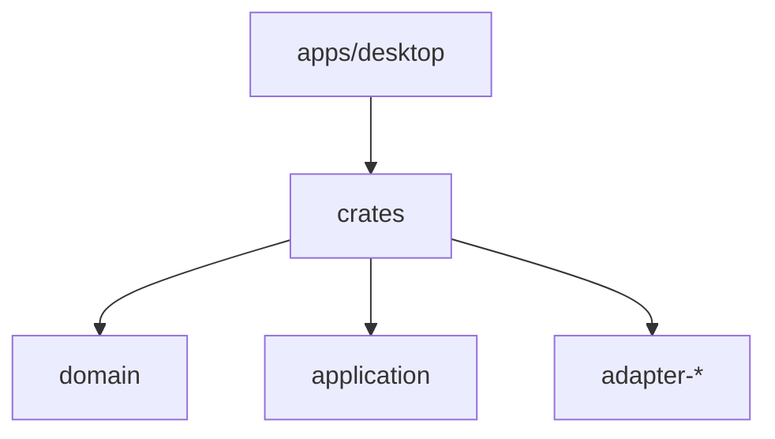

# Codebase Map

## Areas

- `crates/domain` : entités et value objects, sans I/O.
- `crates/application` : cas d'usage et ports.
- `crates/adapter-<provider>` : lecture et interprétation des données d'un provider.
- `crates/adapter-fs` : polling sur la date de modification et résolution des chemins Windows et WSL.
- `crates/overlay` : mode de la fenêtre overlay (click-through ou interactif), sans Tauri, donc testable sur l'hôte.
- `crates/architecture-tests` : test du sens des dépendances hexagonales (`cargo metadata`).
- `apps/desktop/src-tauri` : composition root, application du mode overlay à la fenêtre, raccourci global, event `overlay-mode` et command `overlay_mode`.
- `apps/desktop/src` : UI React, organisée par feature (`features/<feature>/`, aujourd'hui `features/overlay`).

## Entry points

- `apps/desktop/src-tauri/src/main.rs` : démarrage de l'app (binaire `agenthud`), appelle `run()` de `src/lib.rs`.
- `apps/desktop/src/main.tsx` : démarrage de l'UI.

## Packages

- Workspace Cargo racine : `crates/*` et `apps/desktop/src-tauri`.
- Workspace pnpm : `apps/desktop` (package `@agenthud/desktop`). Scripts racine délégués : `typecheck`, `lint`, `test`, `tauri`.
