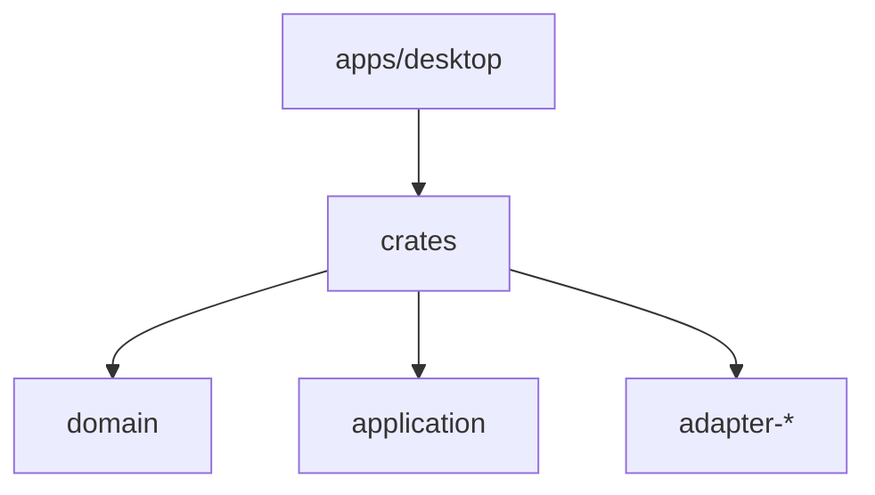

# Codebase Map

## Areas

- `crates/domain` : entités et value objects, sans I/O.
- `crates/application` : cas d'usage et ports. Planificateur pur des sondages distants (`poll_schedule.rs`), source sondée (`polled_usage.rs`), choix de la meilleure source (`freshest_usage.rs`).
- `crates/adapter-<provider>` : lecture et interprétation des données d'un provider. `adapter-codex` : usage en % (sessions, et `codex app-server` dans `app_server.rs` / `app_server_launch.rs`) et état des agents (`task_started`, `task_complete`, `turn_aborted`). `adapter-claude` : % du fichier de la statusline (`statusline_source.rs`), % de l'endpoint OAuth en mode dégradé (`oauth_usage.rs`, `credentials.rs`), tokens sur le bloc de 5 h estimé et état des agents d'après la dernière ligne `assistant` ou `user` des transcripts.
- `crates/adapter-fs` : polling sur la date de modification (fichier le plus récent, fichiers récents), lecture de fin de fichier, horodatages RFC 3339, résolution des chemins Windows et WSL, liste des distros gardée 30 s (`CachedLister`).
- `crates/overlay` : mode de la fenêtre overlay (click-through ou interactif), position ramenée sur un écran existant, options persistées (`options.rs`) et libellés du menu du tray, sans Tauri, donc testable sur l'hôte.
- `crates/architecture-tests` : test du sens des dépendances hexagonales (`cargo metadata`).
- `apps/desktop/src-tauri` : composition root, application du mode overlay à la fenêtre, raccourci global, event `overlay-mode` et command `overlay_mode`. Boucle de polling de l'usage et des agents (`usage_loop.rs`) : events et commands `usage` et `agents`. Sondage des sources distantes (`remote_poll.rs`). Icône et menu du tray, avec les cases des options (`tray.rs`, `options_store.rs`). Position mémorisée de la fenêtre (`window_position.rs`).
- `apps/desktop/src` : UI React, organisée par feature (`features/<feature>/`, aujourd'hui `features/overlay`, `features/usage`, carte d'usage par provider, et `features/agents`, liste des agents affichée dans la carte de son provider).

- `scripts/statusline` : scripts de statusline Claude Code (sh et PowerShell) qui écrivent les quotas pour AgentHud.

## Entry points

- `apps/desktop/src-tauri/src/main.rs` : démarrage de l'app (binaire `agenthud`), appelle `run()` de `src/lib.rs`.
- `apps/desktop/src/main.tsx` : démarrage de l'UI.

## Packages

- Workspace Cargo racine : `crates/*` et `apps/desktop/src-tauri`.
- Workspace pnpm : `apps/desktop` (package `@agenthud/desktop`). Scripts racine délégués : `typecheck`, `lint`, `test`, `tauri`.
